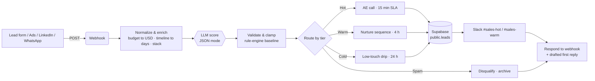

<div align="center">

<h1>AI Lead Qualifier</h1>

<p>Scores every inbound lead 0 to 100, routes it to the right owner with an SLA, and drafts the first reply in seconds.</p>

<p>
  <a href="https://ai-lead-qualifier-self.vercel.app"></a>
  <a href="#n8n-workflow"></a>
  <a href="LICENSE"></a>
  
  
</p>

<p>
  <a href="https://ai-lead-qualifier-self.vercel.app"><strong>Live demo</strong></a> ·
  <a href="#n8n-workflow"><strong>n8n workflow</strong></a> ·
  <a href="#how-it-works"><strong>Architecture</strong></a> ·
  <a href="#run-locally"><strong>Run locally</strong></a>
</p>

</div>

<br>


## Overview

Inbound leads arrive from forms, ads, LinkedIn and referrals, then wait in a shared inbox until someone triages them by hand. Hot buyers sit in the same queue as spam, and the first reply often takes hours. This system qualifies each lead the moment it arrives, sends it to the right owner with a reply deadline, and hands the rep a ready-to-send first email.

## Highlights

- **Score, tier, reasons.** A 0 to 100 score, Hot / Warm / Cold / Spam tier, confidence, weighted intent signals and 12 extracted fields.
- **Policy stays deterministic.** LLM output is validated and clamped to its tier band; routing and SLA are always computed server-side.
- **Drafted first reply.** A personalised email under 120 words, with copy and open-in-mail.
- **Pipeline dashboard.** Kanban with drag-to-retier and live SLA countdowns, a `public.leads` table view, and KPIs.
- **Works without keys.** Demo mode returns realistic deterministic results, and the same engine runs in the browser if the API is unreachable.
- **Production pattern.** Ships with an importable n8n workflow and a Supabase schema with RLS and dashboard views.

## How it works



1. **Normalize and enrich.** Map budget to USD and timeline to days; detect email domain, industry, tools, volume and team size.
2. **LLM score.** The model returns score, tier, confidence, reasons, signals, fields and a reply draft in JSON mode.
3. **Validate.** Tier must be one of four, score is clamped to its band, fields are type-checked.
4. **Route by tier.** See the table below.
5. **Log, notify, respond.** Insert into Supabase, ping Slack with reasons and SLA due time, return the result and reply draft.

| Tier | Score | Route | Owner | SLA |
|---|---|---|---|---|
| Hot | 75 to 100 | AE call | Senior Account Executive | Reply within 15 min |
| Warm | 50 to 74 | Nurture sequence | SDR team | Reply within 4 h |
| Cold | 0 to 49 | Low-touch nurture | Marketing automation | Reply within 24 h |
| Spam | 0 to 10 | Disqualify | None | Archived, never pinged |

**Guards:** POST only, 8 KB body cap, per-field length limits, control-character stripping, best-effort limit of 20 requests per minute per IP, and a prompt that treats lead text as untrusted. The API key never reaches the client.

## Business impact

Typical / estimated, for teams handling 100 to 2,000 inbound leads a month. Not guarantees.

| Metric | Manual triage | With this system |
|---|---|---|
| Time to first response | ~4 to 6 h | ~60% faster, minutes for Hot leads |
| Time to qualify and route | minutes per lead | under 2 s in the demo trace |
| Spam reaching sales Slack | all of it | ~0, pattern and LLM filter |
| Leads with a logged score and reason | rarely | 100%, every row in `public.leads` |

## Tech stack

| Layer | Tools |
|---|---|
| Frontend | HTML, CSS, vanilla JS (ES modules), Inter. No framework, no build step |
| API | Vercel Node serverless function, Node 18+, zero dependencies |
| AI | Gemini 2.0 Flash in JSON mode (demo); any OpenAI-compatible API in n8n |
| Automation | n8n: Webhook, Set, HTTP Request, Code, IF, Respond to Webhook |
| Data | Supabase Postgres with RLS, KPI and queue views |
| Notify | Slack Incoming Webhook |

## Project structure

```
ai-lead-qualifier/
├── index.html                    UI shell
├── assets/
│   ├── app.js                    UI logic, result view, workflow trace
│   ├── engine.js                 Shared scoring engine: rules, extraction, routing, SLA, replies
│   ├── pipeline.js               Pipeline board and localStorage state
│   └── style.css
├── api/qualify.js                POST qualifies a lead · GET returns mode for the badge
├── n8n/ai-lead-qualifier.n8n.json
├── supabase/schema.sql
├── docs/screenshot.png
└── vercel.json
```

## Run locally

```bash
git clone https://github.com/Saitarun29/ai-lead-qualifier
cd ai-lead-qualifier
npx vercel dev    # http://localhost:3000, demo mode without a key
```

For live AI, add `GEMINI_API_KEY=...` to `.env` first. Any static server also works; the app falls back to the in-browser engine.

## Configuration

| Variable | Required | Purpose |
|---|---|---|
| `GEMINI_API_KEY` | No (Vercel) | Enables live AI scoring. Without it the app runs in demo mode |
| `OPENAI_API_KEY` | Yes (n8n) | Key for the LLM scoring HTTP Request |
| `LLM_BASE_URL` | No (n8n) | OpenAI-compatible base URL, default `https://api.openai.com/v1` |
| `LLM_MODEL` | No (n8n) | Default `gpt-4o-mini` |
| `SUPABASE_URL` | Yes (n8n) | e.g. `https://xyz.supabase.co` |
| `SUPABASE_SERVICE_ROLE_KEY` | Yes (n8n) | Server-side insert into `public.leads` |
| `SLACK_WEBHOOK_URL` | Yes (n8n) | Incoming webhook for sales alerts |

## n8n workflow

[`n8n/ai-lead-qualifier.n8n.json`](n8n/ai-lead-qualifier.n8n.json) contains no secrets; every credential is read from `$env`. Spam leads skip the Supabase insert and Slack ping and are answered as archived.

1. In n8n, open **Workflows · Import from file** and select the JSON.
2. Set the n8n variables from the table above on your instance.
3. Run `supabase/schema.sql` in the Supabase SQL editor. It adds `lead_pipeline_kpis` and `lead_queue` views for dashboards.
4. Activate the workflow and point your form at `https://<your-n8n>/webhook/lead-intake`.

## Deploy

[](https://vercel.com/new/clone?repository-url=https://github.com/Saitarun29/ai-lead-qualifier&env=GEMINI_API_KEY)

Zero config. Add `GEMINI_API_KEY` for live AI, or leave it empty to ship in demo mode.

## Roadmap

- Company enrichment (Clearbit / Apollo) and website scraping before scoring
- Round-robin owner assignment and calendar slot booking in the reply
- Two-way CRM sync (HubSpot / Zoho / Salesforce) with `first_reply_at` capture
- Feedback loop where closed-won data recalibrates score weights

<br>

<div align="center">

Built by **Sai Tarun Ronanki** · AI Systems & Agentic Workflows Builder · Hyderabad

[saitarun.com](https://saitarun.com) · [LinkedIn](https://linkedin.com/in/ronanki-sai-tarun) · [X](https://x.com/SaiTarunRonanki)

**[Discuss your workflow →](https://wa.me/918008941430?text=Hello%20Sai%20Tarun%20Ronanki,%20I%20want%20to%20discuss%20about%20my%20workflow)**

MIT © 2026 Sai Tarun Ronanki

</div>
