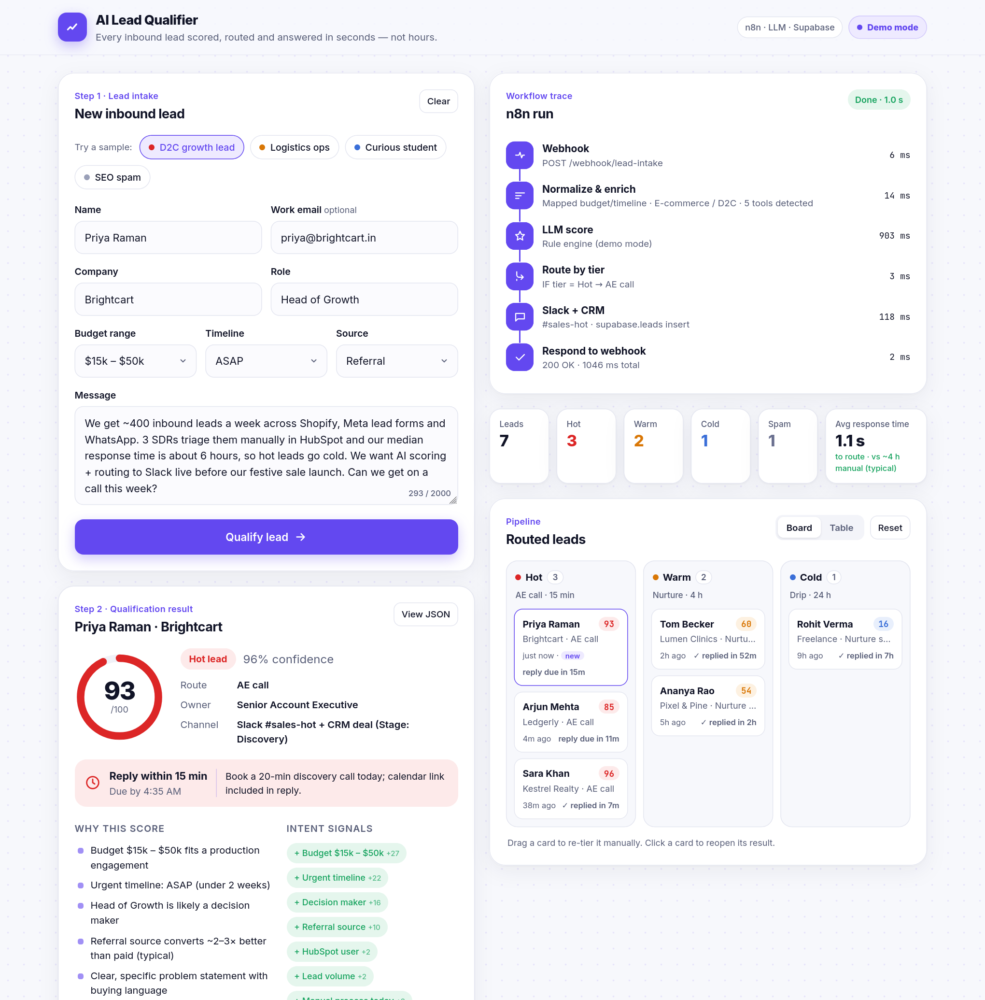

# AI Lead Qualifier

**Every inbound lead scored, routed and answered in seconds, not hours.** An AI qualification system that scores each lead 0–100, sorts it into Hot / Warm / Cold / Spam, routes it to the right owner with an SLA, and drafts a personalised first reply. It follows the same n8n → LLM → Supabase → Slack pattern I run in production.

**Live demo:** https://ai-lead-qualifier-self.vercel.app



---

## The problem

Inbound leads come in from forms, ads, LinkedIn, WhatsApp and referrals. They land in a shared inbox or CRM, and someone has to read and triage each one by hand. So:

- The **first response takes hours.** For many teams the median is 4–6 hours, and most buyers go with whichever vendor replies first.
- **Hot leads wait in the same queue as spam** and students doing research.
- Scoring is **inconsistent**, so it depends on who happens to be on shift.
- There's **no record of *why*** a lead was prioritised, so you can't tune the funnel.

## The solution

A webhook-driven workflow qualifies each lead the moment it arrives:

1. **Normalize & enrich.** Cleans the input, maps budget to USD and timeline to days, and detects the email domain, industry, tools in use, volume and team size.
2. **LLM score.** An LLM in JSON mode returns the score, tier, confidence, reasons, intent signals, extracted fields and a drafted reply. Its output is validated and clamped against a deterministic rule engine.
3. **Route by tier:**
   | Tier | Score | Route | Owner | SLA |
   |---|---|---|---|---|
   | 🔥 Hot | 75–100 | AE call | Senior AE | Reply within **15 min** |
   | 🟠 Warm | 50–74 | Nurture sequence | SDR team | Reply within **4 h** |
   | 🔵 Cold | 0–49 | Nurture sequence (low-touch) | Marketing automation | Reply within **24 h** |
   | ⚪ Spam | 0–10 | Disqualify | — | Archived, never pinged |
4. **Notify + log.** Each lead is written as a row in a Supabase `leads` table. A Slack ping goes to `#sales-hot` / `#sales-warm`, carrying the reasons and the SLA due time.
5. **Respond.** The form gets its answer, and the rep gets a ready-to-send first email.

## Business impact (typical / estimated)

| Metric | Before (manual triage) | After | Notes |
|---|---|---|---|
| Time to first response | ~4–6 h | **~60% faster** (minutes for Hot leads) | Matches the case study on saitarun.com |
| Time to qualify + route | minutes per lead | **< 2 s** | Measured in the demo trace |
| Spam reaching sales Slack | all of it | **~0** | Pattern + LLM filter |
| Leads with a logged score + reason | rarely | **100%** | Every row in `public.leads` |

*Figures are typical for teams handling 100–2,000 inbound leads a month. They are estimates, not guarantees.*

## Architecture


## Features

- **Lead intake form** with name, work email, company, role, budget range, timeline, message and source, plus **4 one-click sample leads** (Hot D2C growth lead, Warm logistics ops, Cold curious student, SEO spam).
- **Qualification result**: an animated 0–100 score ring, tier, confidence, route (action / owner / channel / next step), SLA with due time, reasons, weighted intent signals, 12 extracted fields, and a **drafted personalised first reply** with copy / open-in-mail.
- **Workflow trace** that animates step by step (Webhook → Normalize & enrich → LLM score → Route → Slack + CRM → Respond), with per-step timings from the API.
- **Pipeline dashboard** saved in `localStorage`:
  - a Hot / Warm / Cold **kanban board**, where you drag a card to re-tier it and click a card to reopen its result. Each card shows a live SLA countdown ("reply due in 12m" / "overdue").
  - a **Supabase-style table view** of `public.leads`.
  - **KPIs**: total, Hot, Warm, Cold, Spam blocked, and **average response time** to route.
- **View JSON** shows the raw API response.
- **Live AI or Demo mode badge.** The app is fully usable without any API key.
- Works offline too: if the API isn't reachable, the same engine runs in the browser.
- Responsive, accessible (keyboard-openable cards, reduced motion), with no build step.

## How it works

| Piece | File |
|---|---|
| UI (vanilla JS, ES modules) | `index.html`, `assets/style.css`, `assets/app.js` |
| Shared scoring engine (rules, extraction, routing, SLA, reply drafts) | `assets/engine.js` |
| Serverless API | `api/qualify.js`: `POST` qualifies a lead, `GET` returns the mode for the badge |
| n8n workflow | `n8n/ai-lead-qualifier.n8n.json` |
| Database | `supabase/schema.sql` |

**Live vs demo:** when `GEMINI_API_KEY` is set, `/api/qualify` calls Gemini 2.0 Flash (`responseMimeType: application/json`) with the lead and a rule-engine baseline. The answer is then validated: the tier must be one of the four, the score is clamped into its tier's band, and fields are type-checked. Routing and SLA are always computed server-side, so a model can't invent a policy. If the key is missing or the call fails, the API returns a realistic deterministic result with `mode: "demo"`.

**Guards:** POST only, an 8 KB body cap, per-field length limits, control-character stripping, a best-effort per-IP limit of 20 requests a minute, and a prompt that treats lead text as untrusted. The key is never sent to the client.

### API

```http
POST /api/qualify
Content-Type: application/json

{ "lead": { "name": "Priya Raman", "email": "priya@brightcart.in", "company": "Brightcart",
            "role": "Head of Growth", "budget": "15-50k", "timeline": "asap",
            "source": "referral", "message": "We get ~400 inbound leads a week…" } }
```

Response (abridged):

```json
{
  "mode": "demo", "score": 93, "tier": "Hot", "confidence": 0.96,
  "reasons": ["Budget $15k – $50k fits a production engagement", "Urgent timeline: ASAP", "..."],
  "intent_signals": [{ "label": "Decision maker", "polarity": "positive", "weight": 16 }],
  "extracted": { "industry": "E-commerce / D2C", "use_case": "Lead scoring & routing",
                 "tools_mentioned": ["HubSpot", "Slack", "WhatsApp", "Shopify"], "volume": "400 leads / week" },
  "route": { "action": "AE call", "owner": "Senior Account Executive", "channel": "Slack #sales-hot + CRM deal" },
  "reply": { "subject": "Brightcart × lead scoring & routing — quick call this week?", "body": "Hi Priya, ..." },
  "sla": { "minutes": 15, "label": "Reply within 15 min", "due_at": "2026-10-31T10:15:00.000Z" },
  "processing_ms": 1046,
  "trace": [{ "step": "webhook", "label": "Webhook received", "ms": 6, "detail": "..." }]
}
```

Budget ids: `lt1k`, `1-5k`, `5-15k`, `15-50k`, `50k+`, `unsure`. Timeline ids: `asap`, `month`, `1-3m`, `3-6m`, `exploring`. Source ids: `referral`, `webinar`, `website`, `linkedin`, `google-ads`, `outbound`, `other`.

## Tech stack

- **Frontend:** HTML, CSS and vanilla JS (ES modules), with the Inter font. No framework and no build step.
- **API:** Vercel Node serverless function (Node 18+, global `fetch`), with zero dependencies.
- **AI:** Gemini 2.0 Flash via REST in JSON mode (the demo). The n8n workflow uses any OpenAI-compatible API.
- **Automation:** n8n (Webhook, Set, HTTP Request, Code, IF, Respond to Webhook).
- **Data:** Supabase Postgres, with RLS, KPI and queue views.
- **Notify:** Slack Incoming Webhook.

## Run locally

```bash
git clone https://github.com/Saitarun29/ai-lead-qualifier
cd ai-lead-qualifier
npx vercel dev          # → http://localhost:3000  (demo mode without a key)
```

For live AI, create a `.env` file with `GEMINI_API_KEY=...` before running `npx vercel dev`. Opening `index.html` through any static server also works; the app falls back to the in-browser engine.

## Deploy

[](https://vercel.com/new/clone?repository-url=https://github.com/Saitarun29/ai-lead-qualifier&env=GEMINI_API_KEY)

Zero config. Add `GEMINI_API_KEY` for Live AI, or leave it empty to ship in demo mode.

## Environment variables

| Variable | Where | Required | Purpose |
|---|---|---|---|
| `GEMINI_API_KEY` | Vercel | optional | Enables Live AI scoring. Without it the app runs in demo mode |
| `LLM_BASE_URL` | n8n | optional | OpenAI-compatible base URL (default `https://api.openai.com/v1`) |
| `OPENAI_API_KEY` | n8n | yes (n8n) | Key for the LLM scoring HTTP Request |
| `LLM_MODEL` | n8n | optional | Default `gpt-4o-mini` |
| `SUPABASE_URL` | n8n | yes (n8n) | e.g. `https://xyz.supabase.co` |
| `SUPABASE_SERVICE_ROLE_KEY` | n8n | yes (n8n) | Server-side insert into `public.leads` |
| `SLACK_WEBHOOK_URL` | n8n | yes (n8n) | Incoming webhook for sales alerts |

## n8n workflow

`n8n/ai-lead-qualifier.n8n.json` is an importable workflow with no secrets; every credential comes from `$env`:

```
Webhook (POST /lead-intake)
  → Normalize lead (Set)
  → LLM score (HTTP Request → {LLM_BASE_URL}/chat/completions, JSON mode)
  → Parse score + SLA (Code: validate, clamp, attach route + SLA)
  → IF tier is not Spam
      ├─ true  → Supabase insert lead (HTTP → /rest/v1/leads) → Slack notify (HTTP) → Respond to Webhook
      └─ false → Respond (spam archived)
```

To set it up:

1. In n8n, go to **Workflows → Import from file** and pick the JSON.
2. Set the env vars above on your n8n instance.
3. Run `supabase/schema.sql` in the Supabase SQL editor.
4. Activate the workflow and point your form at `https://<your-n8n>/webhook/lead-intake`.

The schema includes `lead_pipeline_kpis` (counts, average score, average response minutes and SLA breaches per tier) and `lead_queue` (open leads ordered by SLA due time) for dashboards.

## Roadmap

- [ ] Company enrichment (Clearbit / Apollo) and website scraping before scoring
- [ ] Round-robin owner assignment and calendar slot booking in the reply
- [ ] Two-way CRM sync (HubSpot / Zoho / Salesforce) with `first_reply_at` capture
- [ ] Feedback loop: closed-won data recalibrates the score weights
- [ ] WhatsApp Business intake and reply channel

## Author

**Sai Tarun Ronanki**, AI Systems & Agentic Workflows Builder, Hyderabad

- 🌐 [saitarun.com](https://saitarun.com) · ✉️ hello@saitarun.com
- 💼 [LinkedIn](https://linkedin.com/in/ronanki-sai-tarun) · 𝕏 [@SaiTarunRonanki](https://x.com/SaiTarunRonanki) · 📸 [@tarunaistudio](https://instagram.com/tarunaistudio)
- 💬 [Discuss your workflow on WhatsApp](https://wa.me/918008941430?text=Hello%20Sai%20Tarun%20Ronanki,%20I%20want%20to%20discuss%20about%20my%20workflow)

MIT © 2026 Sai Tarun Ronanki
